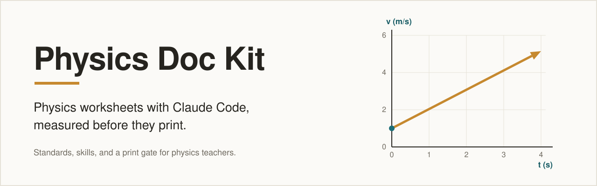
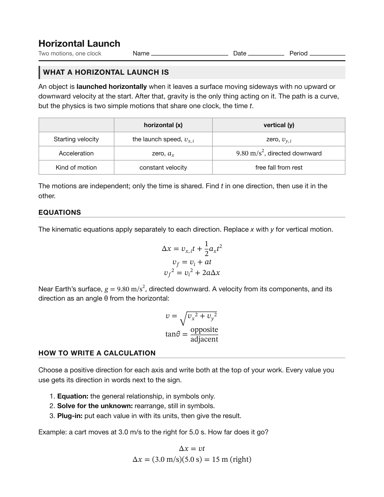
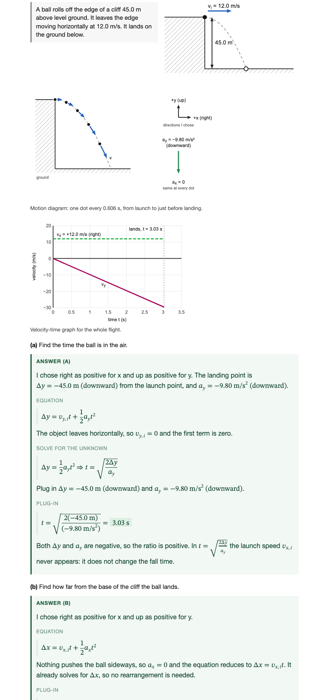
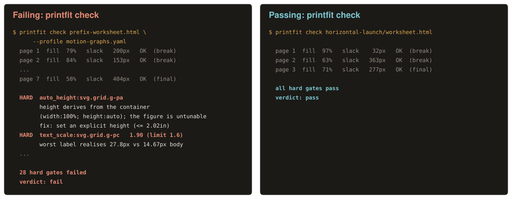

<p align="center">
  <picture>
    <source media="(prefers-color-scheme: dark)" srcset="docs/assets/hero-dark.svg">
    
  </picture>
</p>

<p align="center">
  <a href="LICENSE"></a>
  <a href="standards/LICENSE"></a>
  <a href="https://github.com/adamcelove/physics-doc-kit/actions/workflows/ci.yml"></a>
  
</p>

A Claude Code plugin for physics teachers who build worksheets, quizzes, and answer keys with an LLM. It writes down the rules that make a physics document good (language, work space, figures, equations, keys), teaches Claude to follow them, and then **measures the printed result** before you see it.

## What you get

A worksheet that prints the way you meant it to, every time:

- **Equations as MathML**, not plain-text subscripts.
- **Sized, blank work space** (0.30 in per line, no ruled answer lines), scaled to what each part asks for.
- **An Answer key toggle**: one file, one button (or `?key` in the URL). The blank prints; the key is for the screen.
- **Verified pagination**: a print gate renders the page in Chrome and refuses a worksheet whose figure doubled in height or whose question split from its work space.

| Blank worksheet (what prints) | Key on (what you project) |
|---|---|
|  |  |

Open `examples/horizontal-launch/worksheet.html` in a browser and press **Answer key**.

## What the print gate catches

<p align="center">
  
</p>

Two different documents. Left: real `printfit check` output (shortened) on a deliberately broken synthetic worksheet from the printfit repository. Right: real output on `examples/horizontal-launch/worksheet.html`.

## What's inside

| Standards | Skills and hooks | Print gate |
|---|---|---|
| Plain-prose rules for physics language, work space, diagrams, and keys. Read them, argue with them, fork them. | `worksheet`, `solution-keys`, and `mathml-html` skills load the right standard at the right time; hooks check each file as Claude writes it. | [printfit](https://github.com/adamcelove/printfit) renders in Chrome, measures, and names the element that broke the rule. |

## Requirements

- [Claude Code](https://claude.com/claude-code)
- [uv](https://docs.astral.sh/uv/) (installs printfit)
- Google Chrome or Chromium (printfit renders with it)
- [jq](https://jqlang.org/) (the hooks read tool input with it)

## Install

1. Install the print gate:

   ```
   uv tool install git+https://github.com/adamcelove/printfit
   ```

2. In Claude Code, add this repository as a marketplace and install the plugin (Claude Code 2.1.275 or later):

   ```
   /plugin install physics-doc-kit --marketplace adamcelove/physics-doc-kit
   ```

   Or from a terminal:

   ```
   claude plugin marketplace add adamcelove/physics-doc-kit
   claude plugin install physics-doc-kit@physics-doc-kit
   ```

If `printfit` is missing, the hooks say so once and do nothing else, so the plugin is safe to install first.

## Never used a terminal?

You can install and use the kit entirely from the Claude desktop app.

1. **Add the marketplace.** In the desktop app, go to **Customize > Plugins > Add > Add marketplace** and enter `adamcelove/physics-doc-kit`.
2. **Install the plugin.** Open the **Code** tab, click **+** next to the prompt box, choose **Plugins > Add plugin**, and install **physics-doc-kit**. Start a new session so it loads.
3. **Let Claude install the print gate.** When Claude writes your first worksheet, the kit notices printfit is missing and Claude offers to install it. Each install command appears for you to approve before it runs. Decline and the kit still works, just without the page check.

Plugins installed this way are not available in cloud sessions. The hooks use `jq`, which ships with recent macOS; on older systems, ask Claude to install it.

Verified US K-12 teachers can get Claude, including Claude Code, free through Anthropic's [Claude for Teachers](https://claude.com/solutions/teachers) program. Check that page for current terms.

## No student data

The kit never needs student names, grades, or records. Worksheets are built from physics content alone, with blank name and date lines. Keep student information out of your prompts.

## Your first worksheet

1. Start Claude Code in an empty folder and ask for a printable:

   > Build a two-problem worksheet on horizontal launch. One problem from a cliff, one from a table. Include the answer key.

2. Claude loads the `worksheet` skill and the standards it names, writes a builder script, and builds the HTML. A hook runs `printfit check` on the blank state each time a printable is written.
3. If a hard gate fails, the failure goes back to Claude and it fixes the builder. You see the page table (fill and slack per page) and `verdict: pass` when it is done.
4. Open the HTML. Press **Answer key** to check the solutions. Print: only the blank worksheet prints.

`examples/horizontal-launch/WALKTHROUGH.md` maps each decision in the finished example to the standard behind it.

## In this repository

| Path | What it is |
|---|---|
| `standards/` | The authoring rules in prose (CC BY 4.0) |
| `skills/` | `worksheet`, `solution-keys`, `mathml-html` |
| `hooks/` | MathML guard, print check after each write, key guard |
| `tools/` | MathML builder, SVG arrowheads, answer-key toggle injector |
| `examples/horizontal-launch/` | A complete worksheet and key, with builder and walkthrough |
| `scripts/` | `scrub-check.py`, which keeps private names out of the repo |
| `tests/` | pytest suite for the tools, hooks, and example |

## The standards in brief

- **Motion language.** Direction is a sign on an axis, stated with a direction word. Accelerations are described by the signs of a and v, whether they match or are opposite, and the result: speeding up, slowing down, or changing direction. A few words are banned outright; see `standards/physics-language.md`.
- **Signs are chosen.** Students pick their positive directions; a key says "I chose ..." and restates it in every answer.
- **Work space.** Blank, sized by line count, with a drawing or free-body diagram first when the problem needs one.
- **Keys.** Equation, solve for the unknown in symbols, then substitute with units. Derive symmetry; never assert it. Every worked motion solution gets a motion diagram and a v-t graph.
- **Figures.** Numbered scales and units on every graph axis, explicit sizes, arrow shafts that stop at the head.

## Roadmap

- Misconception library for common wrong answers and distractors
- Lab handout standard and example
- Skills sheets (one-page reference cards) standard and example

## Contributing

See `CONTRIBUTING.md`.

## License

Dual licensed. Code is MIT (see `LICENSE`). The written standards in `standards/` are CC BY 4.0 (see `standards/LICENSE`).
